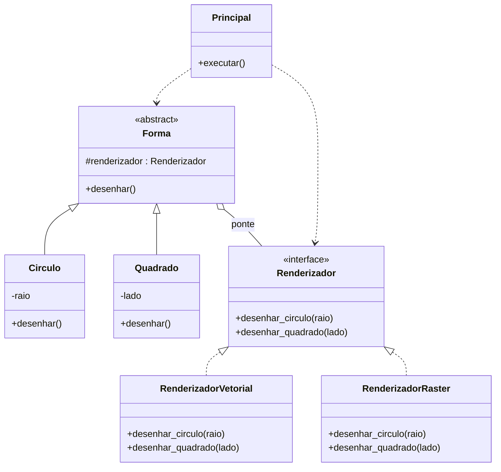

# Exercícios de Padrões de Projeto: Adapter e Bridge

Atividades práticas de Padrões de Projeto (Universidade de Vassouras), feitas em **Python 3**, sem bibliotecas externas.

## Estrutura

```
Exercicio Adapter/
├── Adapter.py   # Exercício 1: Plataforma de música (padrão Adapter)
├── Bridge.py    # Exercício 2: Formas x Renderização (padrão Bridge)
└── README.md
```

## Como executar

```bash
python Adapter.py
python Bridge.py
```

---

## 1. Adapter: Plataforma de música

### Problema

A plataforma toca apenas **MP3**. O novo requisito é tocar também **MP4** e **VLC**, sem alterar a interface original e sem violar o Princípio de Responsabilidade Única (SRP).

### Solução

Cada formato novo ganha um adaptador que traduz o método `tocar()` da interface original para o método da classe incompatível.

| Classe | Papel |
|---|---|
| `Player` | Interface original da plataforma (não muda) |
| `PlayerMP3` | Player que já existia, implementa `Player` |
| `PlayerMP4` | Classe incompatível (`abrir_mp4`) |
| `PlayerVLC` | Classe incompatível (`abrir_vlc`) |
| `AdaptadorMP4` | Adapter: implementa `Player` e usa `PlayerMP4` |
| `AdaptadorVLC` | Adapter: implementa `Player` e usa `PlayerVLC` |
| `Plataforma` | Só conhece `Player`, não sabe nada de formatos |
| `Principal` | Demonstra o uso com MP3, MP4 e VLC |

### Saída

```
Tocando MP3: samba.mp3
Tocando MP4: clipe.mp4
Tocando VLC: show.vlc
```

### Por que respeita o SRP?

- Cada classe tem uma única responsabilidade.
- A `Plataforma` não lida com formatos de arquivo.
- Para um novo formato, basta criar um novo adaptador, sem mexer no código existente.

---

## 2. Bridge: Formas geométricas x Renderização

### Problema

Combinar **formas geométricas** (o que desenhar) com **formas de renderização** (como desenhar) sem criar uma classe para cada combinação (`CirculoVetorial`, `CirculoRaster`, `QuadradoVetorial`, ...).


### Combinação sem classes extras

Com 2 formas e 2 renderizadores, as 4 combinações saem só da montagem dos objetos:

```python
Circulo(vetorial, 5)
Circulo(raster, 5)
Quadrado(vetorial, 4)
Quadrado(raster, 4)
```

### Diagrama de classes



### Saída

```
[Vetorial] Círculo com raio 5 desenhado por curvas
[Raster] Círculo com raio 5 desenhado por pixels
[Vetorial] Quadrado com lado 4 desenhado por linhas
[Raster] Quadrado com lado 4 desenhado por pixels
```

---

## Adapter x Bridge

| | Adapter | Bridge |
|---|---|---|
| Objetivo | Fazer interfaces incompatíveis trabalharem juntas | Separar abstração e implementação para variarem de forma independente |
| Quando usar | Depois que as classes já existem | Ainda no projeto das classes |
| Neste projeto | `AdaptadorMP4` e `AdaptadorVLC` traduzem `tocar()` | `Forma` delega o desenho ao `Renderizador` |